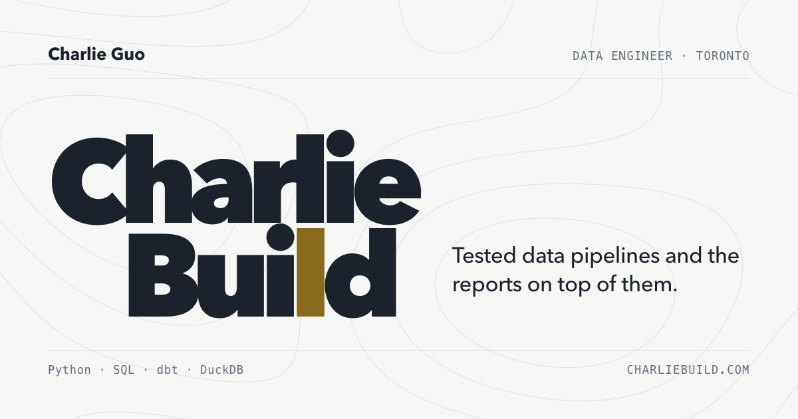

# charliebuild.com

[](https://github.com/welkincz/charliebuild/actions/workflows/ci.yml)

The portfolio of **Charlie Guo**, a data engineer in Toronto. Live at
**[charliebuild.com](https://charliebuild.com/)**.



## What's on the page

| Section | What it shows |
| --- | --- |
| **Hero** | An interactive wordmark: each of the 12 letters swaps for a generated image of an interest. A short statement of what I do sits beside it. |
| **Selected work** | A keyboard-, touch- and screen-reader-friendly carousel of four shipped projects. [Advisor Pulse](https://pulse.charliebuild.com/) leads: a Python + dbt + DuckDB pipeline that turns messy synthetic banking sources into a tested weekly report ([case study](https://pulse.charliebuild.com/case-study), [source](https://github.com/welkincz/advisor-pulse)). |
| **Small tools** | Live utilities rendered from one data file, [`assets/small-tools.js`](assets/small-tools.js). |
| **Résumé** | [`/resume/`](resume/index.html): one HTML source that prints to a one-page, single-column, text-based PDF that ATS parsers read in order. The public copy has no phone number. |
| **Edge readout** | The Cloudflare data centre, HTTP version, TLS version and time to first byte for *your* request, read from `/cdn-cgi/trace` and the Navigation Timing API. |

## How it's built

- **No framework, no build step.** Plain HTML, CSS and JavaScript. What you
  read in this repo is what the browser runs.
- **Text works first.** Every interaction is an enhancement: the letters stay
  letters if an image fails, the carousel is a native scroll container without
  JavaScript, and `prefers-reduced-motion` turns off every animation.
- **Served from the edge.** Cloudflare Workers static assets
  ([`wrangler.jsonc`](wrangler.jsonc)) with security headers and caching in
  [`_headers`](_headers), redirects in [`_redirects`](_redirects) and a real
  404 page.
- **Discoverable.** Canonical URLs, Open Graph and Twitter cards, a
  schema.org `Person` graph, `sitemap.xml` and a generated 1200×630 social
  image ([`scripts/og/og.html`](scripts/og/og.html)).
- **The background is maths, not an image.** A marching-squares contour field
  over a drifting scalar function, drawn on a canvas at about 24 fps and
  paused when the tab is hidden.

## Quality gates

Every push and pull request runs [CI](.github/workflows/ci.yml):

| Check | What it guards |
| --- | --- |
| [`tests/site-contract.mjs`](tests/site-contract.mjs) | Every internal link and asset resolves; meta tags, social image size, JSON-LD, sitemap, 404 handling and security headers are present; repo internals are never published. |
| [`tests/small-tools.mjs`](tests/small-tools.mjs) | The homepage and `/tools/` cards match the data file; image dimensions match the WebP headers. |
| [`tests/nanail-*.mjs`](tests) | The NaNail storefront display and its slideshow timing. |
| [`scripts/check-project-carousel.cjs`](scripts/check-project-carousel.cjs) | Real Chromium and WebKit: arrows, keyboard, touch swipe, rapid input, resize, reduced motion, dark mode, no horizontal overflow and the no-JavaScript fallback. |

## Run it locally

```sh
npm run dev            # python3 -m http.server 8000 → http://localhost:8000
npm test               # static contracts, no dependencies
npm run test:browser   # needs Playwright: npm i --no-save playwright
```

After editing `assets/small-tools.js`, run `npm run render:tools` to stamp the
cards into both pages. After editing `scripts/og/og.html`, run
`npm run render:og`. After editing `resume/index.html`, run
`npm run render:resume` on macOS; `npm test` fails if the PDF is no longer
one page.

## Deploy

Push to `main`; Cloudflare Workers Builds publishes the site. The NaNail
storefront display at `nanail.charliebuild.com` is a separate Worker deployed
with `wrangler deploy --config nanail/wrangler.jsonc`. See
[`docs/nanail-display.md`](docs/nanail-display.md).

## Notes

- Letter asset concepts and constraints: [`docs/letter-assets.md`](docs/letter-assets.md)
- Screenshot provenance: [`docs/project-screenshots.md`](docs/project-screenshots.md)
- The title interaction is informed by
  [`bobobo521/boknows-text-image-template`](https://github.com/bobobo521/boknows-text-image-template)
  (MIT) and was reimplemented for this site.
